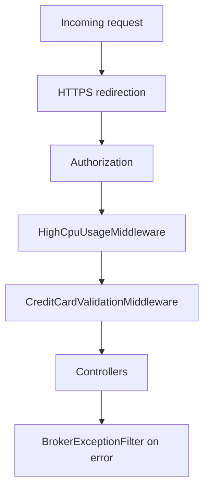

<!-- PAGE_ID: broker-service_01_overview -->

📚 Relevant source files

The following files were used as context for generating this wiki page:

- [README.md:1-52](https://github.com/port-gh-app-dev/broker-service/blob/0e7f657163c06ac393c664199a474abcd896422c/README.md#L1-L52)
- [Program.cs:1-86](https://github.com/port-gh-app-dev/broker-service/blob/0e7f657163c06ac393c664199a474abcd896422c/BrokerService/src/Program.cs#L1-L86)
- [BrokerService.csproj:1-25](https://github.com/port-gh-app-dev/broker-service/blob/0e7f657163c06ac393c664199a474abcd896422c/BrokerService/src/BrokerService.csproj#L1-L25)
- [BrokerServiceDependencyExtension.cs:1-86](https://github.com/port-gh-app-dev/broker-service/blob/0e7f657163c06ac393c664199a474abcd896422c/BrokerService/src/Helpers/BrokerServiceDependencyExtension.cs#L1-L86)

# Overview and Architecture

> **Related Pages**: [[REST API Reference|02_api-reference.md]], [[Configuration, Build and Deployment|05_configuration-deployment.md]]

---

<!-- BEGIN:AUTOGEN broker-service_01_overview_introduction -->
## Introduction

BrokerService manages accounts' balances and processes trades ([README.md:3](https://github.com/port-gh-app-dev/broker-service/blob/0e7f657163c06ac393c664199a474abcd896422c/README.md#L3)). It is an ASP.NET Core application on .NET 8 shipped as a Docker image ([README.md:5-8](https://github.com/port-gh-app-dev/broker-service/blob/0e7f657163c06ac393c664199a474abcd896422c/README.md#L5-L8)). Its namespace is `EasyTrade.BrokerService` ([BrokerService.csproj:6](https://github.com/port-gh-app-dev/broker-service/blob/0e7f657163c06ac393c664199a474abcd896422c/BrokerService/src/BrokerService.csproj#L6)).

| Concern | Technology |
|---------|-----------|
| Web framework | ASP.NET Core Web SDK, `net8.0` ([BrokerService.csproj:1-3](https://github.com/port-gh-app-dev/broker-service/blob/0e7f657163c06ac393c664199a474abcd896422c/BrokerService/src/BrokerService.csproj#L1-L3)) |
| Persistence | Entity Framework Core 9.0.7 with SQL Server ([BrokerService.csproj:17-18](https://github.com/port-gh-app-dev/broker-service/blob/0e7f657163c06ac393c664199a474abcd896422c/BrokerService/src/BrokerService.csproj#L17-L18)) |
| Feature flags | OpenFeature 2.7.0 ([BrokerService.csproj:15](https://github.com/port-gh-app-dev/broker-service/blob/0e7f657163c06ac393c664199a474abcd896422c/BrokerService/src/BrokerService.csproj#L15)) |
| API docs | Swashbuckle.AspNetCore 9.0.3 ([BrokerService.csproj:16](https://github.com/port-gh-app-dev/broker-service/blob/0e7f657163c06ac393c664199a474abcd896422c/BrokerService/src/BrokerService.csproj#L16)) |
| Async startup | HostInitActions 1.3.1 ([BrokerService.csproj:23](https://github.com/port-gh-app-dev/broker-service/blob/0e7f657163c06ac393c664199a474abcd896422c/BrokerService/src/BrokerService.csproj#L23)) |

Accounts and prices are not stored locally. They come from external services, as noted on the database context ([BrokerDbContext.cs:10-11](https://github.com/port-gh-app-dev/broker-service/blob/0e7f657163c06ac393c664199a474abcd896422c/BrokerService/src/BrokerDbContext.cs#L10-L11)).

Sources: [README.md:1-8](https://github.com/port-gh-app-dev/broker-service/blob/0e7f657163c06ac393c664199a474abcd896422c/README.md#L1-L8), [BrokerService.csproj:1-25](https://github.com/port-gh-app-dev/broker-service/blob/0e7f657163c06ac393c664199a474abcd896422c/BrokerService/src/BrokerService.csproj#L1-L25)
<!-- END:AUTOGEN broker-service_01_overview_introduction -->

---

<!-- BEGIN:AUTOGEN broker-service_01_overview_startup -->
## Startup and Request Pipeline

`Program.cs` registers controllers, a permissive CORS policy (any header, method and origin), Swagger, the SQL Server `BrokerDbContext`, a custom logger and an `HttpClient` factory ([Program.cs:13-48](https://github.com/port-gh-app-dev/broker-service/blob/0e7f657163c06ac393c664199a474abcd896422c/BrokerService/src/Program.cs#L13-L48)). The connection string is read from `MSSQL_CONNECTIONSTRING` via `Constants.MsSqlConnectionString` ([Program.cs:31-33](https://github.com/port-gh-app-dev/broker-service/blob/0e7f657163c06ac393c664199a474abcd896422c/BrokerService/src/Program.cs#L31-L33)).

Swagger and the developer exception page are only enabled when the environment is Development ([Program.cs:53-75](https://github.com/port-gh-app-dev/broker-service/blob/0e7f657163c06ac393c664199a474abcd896422c/BrokerService/src/Program.cs#L53-L75)). When `PROXY_PREFIX` is set, the Swagger server URL is rewritten to include it ([Program.cs:58-70](https://github.com/port-gh-app-dev/broker-service/blob/0e7f657163c06ac393c664199a474abcd896422c/BrokerService/src/Program.cs#L58-L70)).

The middleware order is HTTPS redirection, authorization, `HighCpuUsageMiddleware`, `CreditCardValidationMiddleware`, then controllers ([Program.cs:77-84](https://github.com/port-gh-app-dev/broker-service/blob/0e7f657163c06ac393c664199a474abcd896422c/BrokerService/src/Program.cs#L77-L84)).

Sources: [Program.cs:13-86](https://github.com/port-gh-app-dev/broker-service/blob/0e7f657163c06ac393c664199a474abcd896422c/BrokerService/src/Program.cs#L13-L86)
<!-- END:AUTOGEN broker-service_01_overview_startup -->

---

<!-- BEGIN:AUTOGEN broker-service_01_overview_di -->
## Dependency Injection Groups

`AddBrokerServiceDependencyGroup` chains per-domain registrations for accounts, instruments, balances, packages, prices, products, trades, problem patterns and middleware ([BrokerServiceDependencyExtension.cs:24-39](https://github.com/port-gh-app-dev/broker-service/blob/0e7f657163c06ac393c664199a474abcd896422c/BrokerService/src/Helpers/BrokerServiceDependencyExtension.cs#L24-L39)).

- Repositories, services and connectors are transient ([BrokerServiceDependencyExtension.cs:41-68](https://github.com/port-gh-app-dev/broker-service/blob/0e7f657163c06ac393c664199a474abcd896422c/BrokerService/src/Helpers/BrokerServiceDependencyExtension.cs#L41-L68)).
- `ITradeRepository` is bound to `TradeRepositoryWithDbNotResponding`, not the plain `TradeRepository` ([BrokerServiceDependencyExtension.cs:65](https://github.com/port-gh-app-dev/broker-service/blob/0e7f657163c06ac393c664199a474abcd896422c/BrokerService/src/Helpers/BrokerServiceDependencyExtension.cs#L65)).
- The plugin manager, feature provider and flag connector are singletons, and `IPluginManager.InitializeAsync` runs as an async init action at startup ([BrokerServiceDependencyExtension.cs:70-80](https://github.com/port-gh-app-dev/broker-service/blob/0e7f657163c06ac393c664199a474abcd896422c/BrokerService/src/Helpers/BrokerServiceDependencyExtension.cs#L70-L80)).
- The mainframe connector and credit card middleware are singletons ([BrokerServiceDependencyExtension.cs:82-85](https://github.com/port-gh-app-dev/broker-service/blob/0e7f657163c06ac393c664199a474abcd896422c/BrokerService/src/Helpers/BrokerServiceDependencyExtension.cs#L82-L85)).

Sources: [BrokerServiceDependencyExtension.cs:22-86](https://github.com/port-gh-app-dev/broker-service/blob/0e7f657163c06ac393c664199a474abcd896422c/BrokerService/src/Helpers/BrokerServiceDependencyExtension.cs#L22-L86)
<!-- END:AUTOGEN broker-service_01_overview_di -->

---
