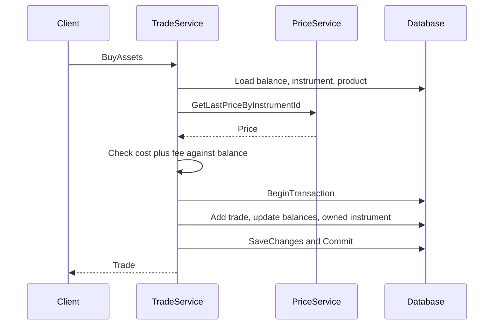
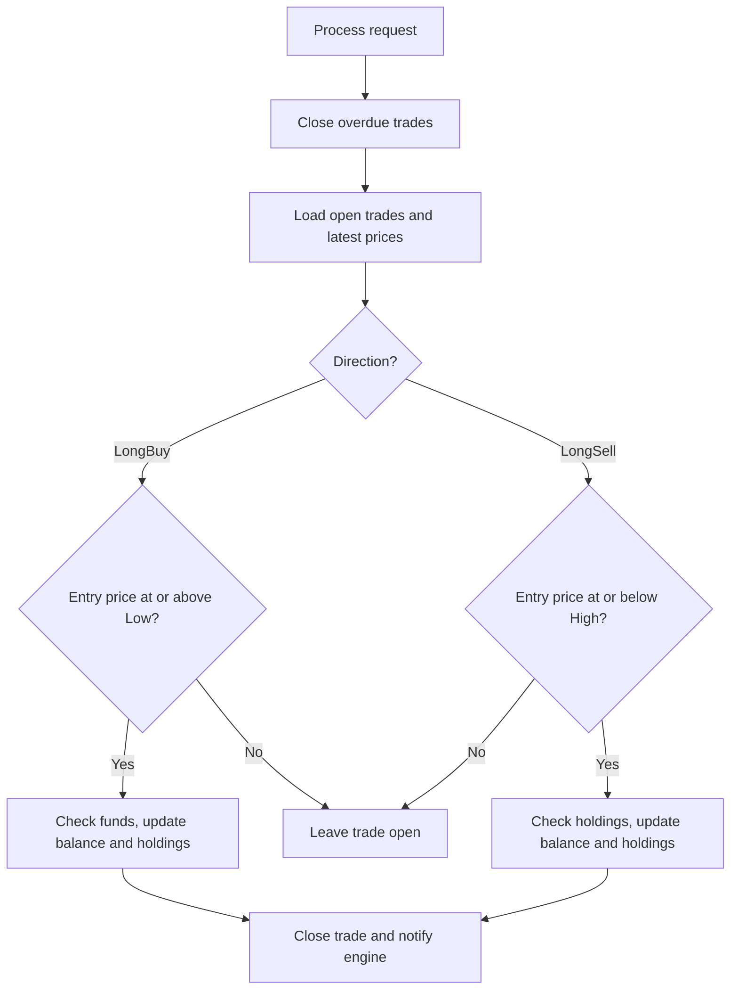

<!-- PAGE_ID: broker-service_03_trading-balances -->

📚 Relevant source files

The following files were used as context for generating this wiki page:

- [BalanceService.cs:1-81](https://github.com/port-gh-app-dev/broker-service/blob/0e7f657163c06ac393c664199a474abcd896422c/BrokerService/src/Entities/Balances/Service/BalanceService.cs#L1-L81)
- [Balance.cs:1-37](https://github.com/port-gh-app-dev/broker-service/blob/0e7f657163c06ac393c664199a474abcd896422c/BrokerService/src/Entities/Balances/Balance.cs#L1-L37)
- [TradeServiceBase.cs:1-122](https://github.com/port-gh-app-dev/broker-service/blob/0e7f657163c06ac393c664199a474abcd896422c/BrokerService/src/Entities/Trades/Service/TradeServiceBase.cs#L1-L122)
- [TradeService.cs:1-151](https://github.com/port-gh-app-dev/broker-service/blob/0e7f657163c06ac393c664199a474abcd896422c/BrokerService/src/Entities/Trades/Service/TradeService.cs#L1-L151)
- [LongTradeService.cs:1-255](https://github.com/port-gh-app-dev/broker-service/blob/0e7f657163c06ac393c664199a474abcd896422c/BrokerService/src/Entities/Trades/Service/LongTradeService.cs#L1-L255)
- [Trade.cs:1-96](https://github.com/port-gh-app-dev/broker-service/blob/0e7f657163c06ac393c664199a474abcd896422c/BrokerService/src/Entities/Trades/Trade.cs#L1-L96)

# Trading and Balance Logic

> **Related Pages**: [[Data Model and External Services|04_data-integrations.md]]

---

<!-- BEGIN:AUTOGEN broker-service_03_trading-balances_balance -->
## Deposits and Withdrawals

`BalanceService.Deposit` and `Withdraw` both call `ModifyBalance` ([BalanceService.cs:13-17](https://github.com/port-gh-app-dev/broker-service/blob/0e7f657163c06ac393c664199a474abcd896422c/BrokerService/src/Entities/Balances/Service/BalanceService.cs#L13-L17)). It loads the balance (throwing `AccountNotFoundException` if missing), builds a `BalanceHistory` row, applies the change, then saves inside a transaction ([BalanceService.cs:28-57](https://github.com/port-gh-app-dev/broker-service/blob/0e7f657163c06ac393c664199a474abcd896422c/BrokerService/src/Entities/Balances/Service/BalanceService.cs#L28-L57)). Any save failure rolls back and is rethrown as `DbException` ([BalanceService.cs:58-64](https://github.com/port-gh-app-dev/broker-service/blob/0e7f657163c06ac393c664199a474abcd896422c/BrokerService/src/Entities/Balances/Service/BalanceService.cs#L58-L64)).

The domain rules live on `Balance`: negative amounts throw `NegativeAmountException`, and a withdrawal above the current value throws `NotEnoughMoneyException` ([Balance.cs:14-36](https://github.com/port-gh-app-dev/broker-service/blob/0e7f657163c06ac393c664199a474abcd896422c/BrokerService/src/Entities/Balances/Balance.cs#L14-L36)).

The set of recorded actions is the `ActionType` enum: Sell, Buy, Deposit, Withdraw, PackageFee, TransactionFee, CollectFee, LongSell, LongBuy ([ActionType.cs:3-14](https://github.com/port-gh-app-dev/broker-service/blob/0e7f657163c06ac393c664199a474abcd896422c/BrokerService/src/Helpers/ActionType.cs#L3-L14)).

Sources: [BalanceService.cs:13-68](https://github.com/port-gh-app-dev/broker-service/blob/0e7f657163c06ac393c664199a474abcd896422c/BrokerService/src/Entities/Balances/Service/BalanceService.cs#L13-L68), [Balance.cs:14-36](https://github.com/port-gh-app-dev/broker-service/blob/0e7f657163c06ac393c664199a474abcd896422c/BrokerService/src/Entities/Balances/Balance.cs#L14-L36)
<!-- END:AUTOGEN broker-service_03_trading-balances_balance -->

---

<!-- BEGIN:AUTOGEN broker-service_03_trading-balances_quick -->
## Quick Buy and Sell

`TradeService.BuyAssets` validates that the amount is not negative, loads the balance and instrument, reads the latest `Open` price from the price service, and loads the product ([TradeService.cs:73-81](https://github.com/port-gh-app-dev/broker-service/blob/0e7f657163c06ac393c664199a474abcd896422c/BrokerService/src/Entities/Trades/Service/TradeService.cs#L73-L81)). The total cost is `amount * price + product.Ppt`. If it exceeds the balance, `NotEnoughMoneyException` is thrown ([TradeService.cs:83-90](https://github.com/port-gh-app-dev/broker-service/blob/0e7f657163c06ac393c664199a474abcd896422c/BrokerService/src/Entities/Trades/Service/TradeService.cs#L83-L90)). Otherwise it opens a transaction, adds the trade, updates balance and owned instrument, and saves ([TradeService.cs:91-100](https://github.com/port-gh-app-dev/broker-service/blob/0e7f657163c06ac393c664199a474abcd896422c/BrokerService/src/Entities/Trades/Service/TradeService.cs#L91-L100)).

`SellAssets` follows the same shape but requires an owned instrument with enough quantity, otherwise `NotEnoughAssetsException` ([TradeService.cs:121-129](https://github.com/port-gh-app-dev/broker-service/blob/0e7f657163c06ac393c664199a474abcd896422c/BrokerService/src/Entities/Trades/Service/TradeService.cs#L121-L129)).

Shared steps are in `TradeServiceBase`. `UpdateBalance` writes two history rows (the trade and a `TransactionFee`) and then credits the fee to the owner account via `CollectFee` ([TradeServiceBase.cs:67-105](https://github.com/port-gh-app-dev/broker-service/blob/0e7f657163c06ac393c664199a474abcd896422c/BrokerService/src/Entities/Trades/Service/TradeServiceBase.cs#L67-L105)). The owner account ID is `Constants.OwnerId = 1` ([Constants.cs:16](https://github.com/port-gh-app-dev/broker-service/blob/0e7f657163c06ac393c664199a474abcd896422c/BrokerService/src/Helpers/Constants.cs#L16)). `SaveChangesOrRollback` commits, or rolls back and throws `DbException` ([TradeServiceBase.cs:107-121](https://github.com/port-gh-app-dev/broker-service/blob/0e7f657163c06ac393c664199a474abcd896422c/BrokerService/src/Entities/Trades/Service/TradeServiceBase.cs#L107-L121)).

A quick trade is created already closed, with `TransactionHappened = true` and the status "Instant {direction} done." ([Trade.cs:56-74](https://github.com/port-gh-app-dev/broker-service/blob/0e7f657163c06ac393c664199a474abcd896422c/BrokerService/src/Entities/Trades/Trade.cs#L56-L74)).

Sources: [TradeService.cs:64-141](https://github.com/port-gh-app-dev/broker-service/blob/0e7f657163c06ac393c664199a474abcd896422c/BrokerService/src/Entities/Trades/Service/TradeService.cs#L64-L141), [TradeServiceBase.cs:67-121](https://github.com/port-gh-app-dev/broker-service/blob/0e7f657163c06ac393c664199a474abcd896422c/BrokerService/src/Entities/Trades/Service/TradeServiceBase.cs#L67-L121)
<!-- END:AUTOGEN broker-service_03_trading-balances_quick -->

---

<!-- BEGIN:AUTOGEN broker-service_03_trading-balances_long -->
## Long-Running Trades

Creating a long trade only registers it: input is validated (amount, price and duration must not be negative), the account and instrument must exist, and an open trade is stored ([LongTradeService.cs:193-209](https://github.com/port-gh-app-dev/broker-service/blob/0e7f657163c06ac393c664199a474abcd896422c/BrokerService/src/Entities/Trades/Service/LongTradeService.cs#L193-L209), [LongTradeService.cs:239-254](https://github.com/port-gh-app-dev/broker-service/blob/0e7f657163c06ac393c664199a474abcd896422c/BrokerService/src/Entities/Trades/Service/LongTradeService.cs#L239-L254)). Its `TimestampClose` is now plus `duration` hours and its status is "{direction} registered." ([Trade.cs:76-95](https://github.com/port-gh-app-dev/broker-service/blob/0e7f657163c06ac393c664199a474abcd896422c/BrokerService/src/Entities/Trades/Trade.cs#L76-L95)).

`ProcessLongRunningTransactions` (triggered by `POST /v1/trade/long/process`) first closes overdue trades with the status "Time is up: trade failed" ([LongTradeService.cs:66-68](https://github.com/port-gh-app-dev/broker-service/blob/0e7f657163c06ac393c664199a474abcd896422c/BrokerService/src/Entities/Trades/Service/LongTradeService.cs#L66-L68), [LongTradeService.cs:229-237](https://github.com/port-gh-app-dev/broker-service/blob/0e7f657163c06ac393c664199a474abcd896422c/BrokerService/src/Entities/Trades/Service/LongTradeService.cs#L229-L237)). It then loads open trades, instruments, latest prices and products, and handles each trade ([LongTradeService.cs:70-117](https://github.com/port-gh-app-dev/broker-service/blob/0e7f657163c06ac393c664199a474abcd896422c/BrokerService/src/Entities/Trades/Service/LongTradeService.cs#L70-L117)):

- A long buy executes only when its entry price is at or above the price's `Low`. It fails if funds are insufficient ([LongTradeService.cs:129-143](https://github.com/port-gh-app-dev/broker-service/blob/0e7f657163c06ac393c664199a474abcd896422c/BrokerService/src/Entities/Trades/Service/LongTradeService.cs#L129-L143)).
- A long sell executes only when its entry price is at or below the price's `High`. It fails if holdings are insufficient ([LongTradeService.cs:153-170](https://github.com/port-gh-app-dev/broker-service/blob/0e7f657163c06ac393c664199a474abcd896422c/BrokerService/src/Entities/Trades/Service/LongTradeService.cs#L153-L170)).
- Every closed trade triggers `ITradeNotificationService.OnTradeClosed` ([LongTradeService.cs:212-227](https://github.com/port-gh-app-dev/broker-service/blob/0e7f657163c06ac393c664199a474abcd896422c/BrokerService/src/Entities/Trades/Service/LongTradeService.cs#L212-L227)).

Sources: [LongTradeService.cs:62-255](https://github.com/port-gh-app-dev/broker-service/blob/0e7f657163c06ac393c664199a474abcd896422c/BrokerService/src/Entities/Trades/Service/LongTradeService.cs#L62-L255)
<!-- END:AUTOGEN broker-service_03_trading-balances_long -->

---
