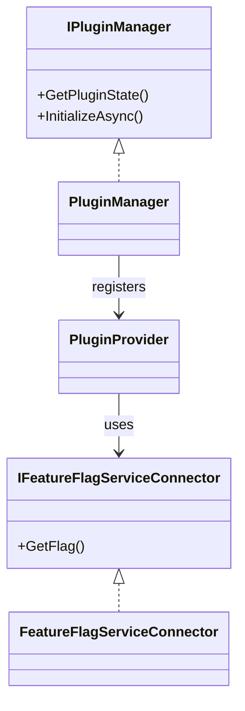

<!-- PAGE_ID: broker-service_06_problem-patterns -->

📚 Relevant source files

The following files were used as context for generating this wiki page:

- [PluginManager.cs:1-39](https://github.com/port-gh-app-dev/broker-service/blob/0e7f657163c06ac393c664199a474abcd896422c/BrokerService/src/ProblemPatterns/OpenFeature/PluginManager.cs#L1-L39)
- [PluginProvider.cs:1-53](https://github.com/port-gh-app-dev/broker-service/blob/0e7f657163c06ac393c664199a474abcd896422c/BrokerService/src/ProblemPatterns/OpenFeature/Providers/PluginProvider.cs#L1-L53)
- [FeatureFlagServiceConnector.cs:1-37](https://github.com/port-gh-app-dev/broker-service/blob/0e7f657163c06ac393c664199a474abcd896422c/BrokerService/src/ProblemPatterns/OpenFeature/Providers/FeatureFlagService/FeatureFlagServiceConnector.cs#L1-L37)
- [HighCpuUsageMiddleware.cs:1-72](https://github.com/port-gh-app-dev/broker-service/blob/0e7f657163c06ac393c664199a474abcd896422c/BrokerService/src/ProblemPatterns/HighCpuUsage/HighCpuUsageMiddleware.cs#L1-L72)
- [TradeRepositoryWithDbNotResponding.cs:1-29](https://github.com/port-gh-app-dev/broker-service/blob/0e7f657163c06ac393c664199a474abcd896422c/BrokerService/src/ProblemPatterns/DbNotResponding/TradeRepositoryWithDbNotResponding.cs#L1-L29)
- [CreditCardValidationMiddleware.cs:1-83](https://github.com/port-gh-app-dev/broker-service/blob/0e7f657163c06ac393c664199a474abcd896422c/BrokerService/src/Middleware/CreditCardValidation/CreditCardValidationMiddleware.cs#L1-L83)
- [MainframeServiceConnector.cs:1-62](https://github.com/port-gh-app-dev/broker-service/blob/0e7f657163c06ac393c664199a474abcd896422c/BrokerService/src/Middleware/CreditCardValidation/MainframeServiceConnector.cs#L1-L62)

# Problem Patterns and Feature Flags

> **Related Pages**: [[Configuration, Build and Deployment|05_configuration-deployment.md]]

---

<!-- BEGIN:AUTOGEN broker-service_06_problem-patterns_flags -->
## Feature Flag Plumbing

Problem patterns are toggled through an external feature flag service ([README.md:34](https://github.com/port-gh-app-dev/broker-service/blob/0e7f657163c06ac393c664199a474abcd896422c/README.md#L34)). `PluginManager.GetPluginState` serves values from an in-memory cache and otherwise asks the OpenFeature client, caching the result for the configured number of seconds (default 60) ([PluginManager.cs:11-29](https://github.com/port-gh-app-dev/broker-service/blob/0e7f657163c06ac393c664199a474abcd896422c/BrokerService/src/ProblemPatterns/OpenFeature/PluginManager.cs#L11-L29)). `InitializeAsync` registers the provider with OpenFeature once ([PluginManager.cs:31-38](https://github.com/port-gh-app-dev/broker-service/blob/0e7f657163c06ac393c664199a474abcd896422c/BrokerService/src/ProblemPatterns/OpenFeature/PluginManager.cs#L31-L38)).

`PluginProvider` is a custom OpenFeature provider. Only boolean resolution is implemented: it fetches the flag and returns its `Enabled` value, or the default if the flag is missing. Double, integer, string and structure resolution throw `NotImplementedException` ([PluginProvider.cs:14-52](https://github.com/port-gh-app-dev/broker-service/blob/0e7f657163c06ac393c664199a474abcd896422c/BrokerService/src/ProblemPatterns/OpenFeature/Providers/PluginProvider.cs#L14-L52)). `FeatureFlagServiceConnector` calls `GET {protocol}://{baseUrl}:{port}/v1/flags/{id}` and returns null on a non-200 response ([FeatureFlagServiceConnector.cs:15-29](https://github.com/port-gh-app-dev/broker-service/blob/0e7f657163c06ac393c664199a474abcd896422c/BrokerService/src/ProblemPatterns/OpenFeature/Providers/FeatureFlagService/FeatureFlagServiceConnector.cs#L15-L29)).

Sources: [PluginManager.cs:7-38](https://github.com/port-gh-app-dev/broker-service/blob/0e7f657163c06ac393c664199a474abcd896422c/BrokerService/src/ProblemPatterns/OpenFeature/PluginManager.cs#L7-L38), [PluginProvider.cs:7-24](https://github.com/port-gh-app-dev/broker-service/blob/0e7f657163c06ac393c664199a474abcd896422c/BrokerService/src/ProblemPatterns/OpenFeature/Providers/PluginProvider.cs#L7-L24), [FeatureFlagServiceConnector.cs:6-37](https://github.com/port-gh-app-dev/broker-service/blob/0e7f657163c06ac393c664199a474abcd896422c/BrokerService/src/ProblemPatterns/OpenFeature/Providers/FeatureFlagService/FeatureFlagServiceConnector.cs#L6-L37)
<!-- END:AUTOGEN broker-service_06_problem-patterns_flags -->

---

<!-- BEGIN:AUTOGEN broker-service_06_problem-patterns_patterns -->
## Patterns

| Flag | Effect | Source |
|------|--------|--------|
| `db_not_responding` | `TradeRepositoryWithDbNotResponding.AddTrade` sets the trade ID to `-1` (`InvalidTradeId`) before adding it, so the insert fails ([TradeRepositoryWithDbNotResponding.cs:13-20](https://github.com/port-gh-app-dev/broker-service/blob/0e7f657163c06ac393c664199a474abcd896422c/BrokerService/src/ProblemPatterns/DbNotResponding/TradeRepositoryWithDbNotResponding.cs#L13-L20), [Constants.cs:17-18](https://github.com/port-gh-app-dev/broker-service/blob/0e7f657163c06ac393c664199a474abcd896422c/BrokerService/src/Helpers/Constants.cs#L17-L18)) |
| `high_cpu_usage` | Each request first runs `concurrency` tasks computing Collatz sequences of random numbers until the delay elapses ([HighCpuUsageMiddleware.cs:28-49](https://github.com/port-gh-app-dev/broker-service/blob/0e7f657163c06ac393c664199a474abcd896422c/BrokerService/src/ProblemPatterns/HighCpuUsage/HighCpuUsageMiddleware.cs#L28-L49), [HighCpuUsageMiddleware.cs:51-71](https://github.com/port-gh-app-dev/broker-service/blob/0e7f657163c06ac393c664199a474abcd896422c/BrokerService/src/ProblemPatterns/HighCpuUsage/HighCpuUsageMiddleware.cs#L51-L71)) |
| `credit_card_validation` | On POST `/v1/balance/{id}/deposit` or `/withdraw`, the body's `cardNumber` is validated against the mainframe ([CreditCardValidationMiddleware.cs:14-80](https://github.com/port-gh-app-dev/broker-service/blob/0e7f657163c06ac393c664199a474abcd896422c/BrokerService/src/Middleware/CreditCardValidation/CreditCardValidationMiddleware.cs#L14-L80)) |

All three flags default to off ([HighCpuUsageMiddleware.cs:30](https://github.com/port-gh-app-dev/broker-service/blob/0e7f657163c06ac393c664199a474abcd896422c/BrokerService/src/ProblemPatterns/HighCpuUsage/HighCpuUsageMiddleware.cs#L30), [CreditCardValidationMiddleware.cs:16-19](https://github.com/port-gh-app-dev/broker-service/blob/0e7f657163c06ac393c664199a474abcd896422c/BrokerService/src/Middleware/CreditCardValidation/CreditCardValidationMiddleware.cs#L16-L19), [TradeRepositoryWithDbNotResponding.cs:25](https://github.com/port-gh-app-dev/broker-service/blob/0e7f657163c06ac393c664199a474abcd896422c/BrokerService/src/ProblemPatterns/DbNotResponding/TradeRepositoryWithDbNotResponding.cs#L25)).

The `db_not_responding` check blocks on `Task.Run(...).Result` ([TradeRepositoryWithDbNotResponding.cs:22-28](https://github.com/port-gh-app-dev/broker-service/blob/0e7f657163c06ac393c664199a474abcd896422c/BrokerService/src/ProblemPatterns/DbNotResponding/TradeRepositoryWithDbNotResponding.cs#L22-L28)).

### Credit card validation behavior

- A missing card number lets the request through ("failing open") ([CreditCardValidationMiddleware.cs:33-41](https://github.com/port-gh-app-dev/broker-service/blob/0e7f657163c06ac393c664199a474abcd896422c/BrokerService/src/Middleware/CreditCardValidation/CreditCardValidationMiddleware.cs#L33-L41)).
- An invalid card returns 400 with "Credit card validation failed" ([CreditCardValidationMiddleware.cs:43-55](https://github.com/port-gh-app-dev/broker-service/blob/0e7f657163c06ac393c664199a474abcd896422c/BrokerService/src/Middleware/CreditCardValidation/CreditCardValidationMiddleware.cs#L43-L55)).
- The connector POSTs to `{MAINFRAME_SERVICE_URL}/zosConnect/services/creditcardCheck?action=invoke`, and treats any success status as valid ([MainframeServiceConnector.cs:32-51](https://github.com/port-gh-app-dev/broker-service/blob/0e7f657163c06ac393c664199a474abcd896422c/BrokerService/src/Middleware/CreditCardValidation/MainframeServiceConnector.cs#L32-L51)).
- A missing URL or any request exception also fails open ([MainframeServiceConnector.cs:22-30](https://github.com/port-gh-app-dev/broker-service/blob/0e7f657163c06ac393c664199a474abcd896422c/BrokerService/src/Middleware/CreditCardValidation/MainframeServiceConnector.cs#L22-L30), [MainframeServiceConnector.cs:53-60](https://github.com/port-gh-app-dev/broker-service/blob/0e7f657163c06ac393c664199a474abcd896422c/BrokerService/src/Middleware/CreditCardValidation/MainframeServiceConnector.cs#L53-L60)).
- Its `HttpClient` accepts any server TLS certificate (`DangerousAcceptAnyServerCertificateValidator`), so the mainframe's certificate is never verified ([MainframeServiceConnector.cs:12-18](https://github.com/port-gh-app-dev/broker-service/blob/0e7f657163c06ac393c664199a474abcd896422c/BrokerService/src/Middleware/CreditCardValidation/MainframeServiceConnector.cs#L12-L18)).

Sources: [README.md:30-52](https://github.com/port-gh-app-dev/broker-service/blob/0e7f657163c06ac393c664199a474abcd896422c/README.md#L30-L52), [CreditCardValidationMiddleware.cs:1-83](https://github.com/port-gh-app-dev/broker-service/blob/0e7f657163c06ac393c664199a474abcd896422c/BrokerService/src/Middleware/CreditCardValidation/CreditCardValidationMiddleware.cs#L1-L83), [MainframeServiceConnector.cs:1-62](https://github.com/port-gh-app-dev/broker-service/blob/0e7f657163c06ac393c664199a474abcd896422c/BrokerService/src/Middleware/CreditCardValidation/MainframeServiceConnector.cs#L1-L62)
<!-- END:AUTOGEN broker-service_06_problem-patterns_patterns -->

---
